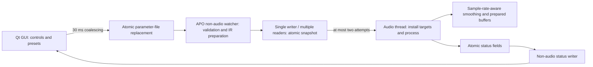

# DreamDSP

A system-wide audio DSP application for Windows, built with Qt 6 / QML and
[HuskarUI](https://github.com/mengps/HuskarUI).

Comparable in intent to [JamesDSP](https://github.com/james34602/JamesDSPManager) /
[RootlessJamesDSP](https://github.com/timschneeb/RootlessJamesDSP) on Android and
to ViPER4Windows here — a full effects rack, not just an equalizer.

## Architecture

Two pieces, split along a line that matters:

```
DreamDSP.exe      Qt/QML interface -- configuration, presets, analysis
DreamDspApo.dll   the audio processing object, loaded into audiodg.exe
```

DreamDSP registers its own APO and attaches it to an endpoint's post-mix slot,
so the whole rack runs inside the Windows audio engine:

```
audio -> Windows Audio Engine -> DreamDspApo.dll
                                   equalizer -> bass -> exciter -> tube
                                   -> compressor -> multiband -> reverb
                                   -> width -> crossfeed -> convolution
                                        ^ reads
                        C:\ProgramData\DreamDSP\control\params.bin
                        C:\ProgramData\DreamDSP\status.bin  <- APO writes back
```

Parameters travel, not filter coefficients: a version-11, 1704-byte scalar block,
published by replacing a file (so the kernel provides the atomicity), read
through a bounded atomic-word snapshot, and sanitised on both sides. A hostile IIR
denominator cannot be told apart from a legitimate one by any cheap test, which
would leave an unbounded-gain path into a system audio process; bounded scalars
can be checked exactly.

**Equalizer APO is not required.** It was, up to 0.1.0: the equalizer was
emitted as `Filter N:` lines into `config/dreamdsp.txt` and APO executed them.
The equalizer now runs in DreamDSP's own APO, in double precision, with the
filter design shared between the audio path and the curve on screen -- so the
plotted response is read out of the coefficients the audio actually goes
through, verified against the measured impulse response to 0.0000 dB.

Equalizer APO remains supported as a fallback for an endpoint DreamDSP's own
object is not attached to, and its file formats remain supported as import and
export. Exactly one of the two applies the curve at any time; attaching
DreamDSP's object removes the `Include:` line, and the interface says which
program is doing the work.

## Effect inventory

Everything runs in DreamDSP's own APO.

| Effect | Status |
|---|---|
| Parametric EQ, 32 bands, 18 filter types, double precision | done |
| Graphic EQ, 31 ISO bands, fitted from AutoEQ `GraphicEQ:` curves | in the same card as the parametric bands |
| Preamp, per-device profiles | done |
| AutoEQ headphone correction (20,777 curves) | done |
| Peace `.peace` preset interop | done |
| PEQ curve `.xml` import/export (the `<FiiO_DSP>` document) | done |
| Convolution / impulse response, any rate, any file rate | done |
| Compressor, with auto knee/attack/release/makeup | done |
| Three-band multiband compressor | done |
| Algorithmic reverb | done |
| Eight-line Householder FDN reverb, damped RT60 / pre-delay | done |
| Chorus / Flanger / six-stage Phaser | done |
| Measured KEMAR binaural virtual speakers, azimuth / elevation | stereo headphones; legacy spherical head retained |
| Synthetic Memory Drive, trained eight-unit recurrent saturator | 8–192 kHz host rates, fixed 48 kHz model |
| Tape-style saturation, 4x oversampling / head bump / memory | done; algorithmic approximation |
| Split-band de-esser, linked multichannel detector | done |
| Noise gate, linked peak detector / hysteresis / hold | done; playback noise in pauses |
| Three-band dynamic EQ, independent frequency / Q / downward compression | done |
| Tube saturation, exciter | done |
| Psychoacoustic virtual bass | done |
| Stereo widener, crossfeed | done |
| Dynamic bass boost (level-following) | done |
| Look-ahead peak limiter, true-peak (BS.1770, 4x) | done |
| Soft clipper with a quadratic knee, ahead of the limiter | done |
| Transient shaper (attack / sustain, no threshold) | done |
| Auto volume (BS.1770 loudness levelling) | done |
| Night mode (the five Dolby DRC curves) | done |
| Phantom-source widening (Zotter-Frank) | done |
| User-orderable chain | done |
| Channel routing matrix (APO `Copy:`) | done |
| Per-channel delay (APO `Delay:`), sub-sample | done |
| Loudness correction (APO `LoudnessCorrection:`) | done |
| ViPER **DDC** (`.vdc`) import | not planned |
| Capture (microphone) endpoints | not supported |
| VST plugin hosting | not planned -- see below |
| Liveprog (EEL2 scripting) | not planned -- see below |

Filters that Equalizer APO never implemented -- `BWLP`, `BWHP`, `LRLP`, `LRHP`,
which are Peace's spelling and which APO 1.4.2 logs as invalid and drops -- are
implemented here as genuine fourth-order sections.

Two places where the reimplementation is deliberately not a copy. The delay
interpolates to sub-sample resolution: APO rounds to whole samples, which at
48 kHz quantises speaker alignment to 7.1 mm of path length, the same order as
the distances being corrected. And the loudness correction takes the endpoint
volume from the interface rather than from a polling thread inside audiodg.exe,
so the DSP stage stays a pure function of its parameters and the system audio
process makes no COM calls of its own. The correction curve itself is APO's
formula, reproduced exactly.

**The chain order is the user's.** Stages run in whatever order the chain
editor puts them in; `kDefaultOrder` is a default, not a constraint. The order
travels as a permutation of the thirty stage ids, and the sanitiser replaces
anything that is not a permutation wholesale rather than patching it -- a
duplicate would run a stage twice and an omission would silently drop an effect
whose switch says it is on.

**Four earlier stages came out of a measurement exercise**, written up in
[`docs/effects-research.md`](docs/effects-research.md). Three of them exist
because the measurement said something a datasheet would not:

- **The clipper goes before the limiter** because at one decibel of peak
  reduction a clipper adds 0.1 dB of amplitude modulation to sustained content
  where a look-ahead limiter adds 17 to 20 dB, and delivers more loudness for
  the same ceiling. The reason is duty cycle: clipping touches 0.02% of samples
  in bursts under three samples long, each masked by the transient that caused
  it. This only holds for a near-hard knee -- `tanh` and friends add as much
  modulation as the limiter, because they compress everything all the time.
- **Its knee is one decibel wide** because that is the cheapest decibel in the
  rack: measured here, 51.5 dB of alias-to-signal becomes 69.0 dB for one
  hundredth of a decibel of loudness. Adding 2x oversampling takes it to
  82.6 dB.
- **The transient shaper has no threshold** because its gain comes from the
  difference between two envelopes of the same signal, which is a ratio and
  therefore scale-invariant. Measured, the same drum burst 20 dB apart draws
  gain trajectories 0.000 dB apart -- something a compressor cannot do, because
  its gain is a function of level minus threshold. It does need a *gate*, which
  is a different thing: level independence means it would chase a -75 dBFS room
  tone exactly as hard as a -30 dBFS one.
- **Night mode's curves are not from the AC-3 specification**, which
  standardises only the transport of the gain word. They are Dolby's five
  published profiles, taken from ETSI TS 103 190-1 Table 161 -- which also
  carries the time constants Dolby's own metadata guide omits, and which
  corrects two arithmetic slips in that guide's Film Light row. The self-test
  checks all five against their documented ratios.

The same exercise found four defects in stages that already shipped: a
half-wet tube stage was notching itself by 17.8 dB at 18.7 kHz (the dry and wet
paths were mixed on opposite sides of an oversampler); the exciter ran at 20 dB
of alias-to-signal where 4x oversampling gives 89; the virtual bass's harmonic
balance drifted 18.5 dB over 20 dB of programme level; and the limiter's
"threshold is a guarantee" was true only of the sample values, with the
reconstructed waveform exceeding it by 0.90 dBTP.

**The graphic equalizer is a filter bank, not an FIR.** JamesDSP and Equalizer
APO both realise arbitrary magnitude curves with an FIR; this uses 31 ISO
third-octave peaking sections, and the band gains are solved for so the cascade
matches the requested curve rather than merely being set to it (which is wrong
by 12 dB on a real curve, because the bands overlap). Three reasons: a
partitioned convolver's latency is its block size, which is milliseconds added
to every stream for an equalizer; only bounded gains can travel on the wire,
where coefficients cannot be validated at all; and the design is the same
`designFilter()` the parametric bands already use and that is already tested
against measured impulse responses. The cost is resolution -- third-octave
against an FIR's ability to follow a curve as sharply as its length allows.
Measured, a 60-point AutoEQ-shaped curve lands within 0.007 dB.

**VST hosting is not planned.** APO can afford it because it guards every
plugin call and drops a plugin that faults; DreamDSP would be handing arbitrary
third-party code a real-time thread inside `audiodg.exe`, where a fault takes
the machine's audio with it. `Stage:` is likewise absent because it is a
config-file concept -- selecting which APO slot a section applies to -- and
`If`/`Eval` because per-device profiles already cover what it is used for.
Liveprog is the same objection one step milder -- a sandboxed interpreter rather
than native code -- but it is a language implementation, not an effect, and a
runaway script on a real-time thread inside a system audio process is a poor
place to find that out.

## DSP expansion

The Effects page includes ten new cards, head-fixed top and side views of the
virtual speakers, and the existing endpoint output meter. Every new stage
participates in chain ordering, session restore and `.dreamdsp` preset round
trips. Version 2–10 session blocks are migrated on GUI/APO load; existing stage
order is preserved and missing stages start disabled. Version-8 binaural
settings keep the legacy horizontal model and sound. GUI and APO must be deployed
together: an older APO intentionally rejects the version-11 wire format.



The snapshot uses atomic payload words as well as an atomic sequence counter;
a sequence counter around ordinary concurrent `memcpy` would still be a C++
data race. Failed reads preserve the previous valid parameters. No Qt objects,
file operations, model loading or allocation occur inside the processing loop.
Storage and HRTF tables are prepared before processing. Enable transitions
clear prepared state, so toggle cost still belongs in the callback budget.

- **Binaural** renders all four speaker-to-ear paths with prepared FIR banks,
  smoothed azimuth/elevation and a 20 ms crossfade between models. Model 1 uses
  the diffuse-field KEMAR measurements by **Bill Gardner and Keith Martin,
  MIT Media Laboratory (1994)**; data provenance, attribution permission and
  the reproducible converter are in [dsp/hrtf/NOTICE.md](dsp/hrtf/NOTICE.md).
  The UI keeps the listener facing the screen: speaker spread is the full angle,
  rotation is clockwise, and elevation ranges from -40° below the ears to +90°
  overhead. Generic pinna spectral cues provide height information, but perceived
  localisation depends on the listener and headphones. Model 0 preserves the
  earlier horizontal spherical head. Only stereo layouts are processed; there
  is no head tracking, SOFA import or Ambisonics decoder. At 48 kHz the measured
  model has 224 taps and 35 samples of causal resampling padding, plus the native
  HRIR arrival delays; the legacy model's common offset is 29 samples. Neither
  adds a block buffer. These acoustic delays are distinct from `latencySamples()`.
  Use fully wet; mixing direct dry audio changes phase and timbre.
- **Cinema space** selects measured HRTFs with 64° speaker spread, +8° elevation
  and -6 dB output, followed by a light FDN room (0.75 s decay, 14 ms pre-delay,
  12% mix). The button places FDN directly after Binaural and disables legacy
  reverb, width and crossfeed; other effects and master bypass are preserved.
  This is stereo virtual-speaker rendering, not Dolby Atmos decoding or a
  reconstruction of missing surround/object channels. Use ordinary stereo input
  and headphones; avoid processing material already rendered to binaural audio
  or stacking another system spatial renderer.
- **Neural saturation** uses an original eight-unit echo-state network with a
  trained linear readout, independent state per channel, parameter smoothing
  and a DC blocker. `scripts/train-neural-saturation.py` reproduces the weights
  using only Python's standard library. The checked-in JSON records provenance
  and a held-out synthetic-teacher ESR of -39.06 dB. This is a synthetic effect,
  not a measured amplifier/tape/tube capture or a quality claim against hardware.
  It accepts host rates from 8 to 192 kHz and 1–8 channels. The recurrent model
  always runs at its training rate, 48 kHz; other rates use prepared causal
  windowed-sinc converters with anti-alias filtering. The dry path is delayed
  to the wet path's integer-sample latency, independent of callback block size.
  Native 48 kHz retains the original path and zero buffering latency. Common
  44.1/88.2/96/176.4/192 kHz rates add approximately 1.3–1.5 ms; 8 kHz adds 8 ms.
  Model input is bounded to +/-2. This is rate adaptation, not an oversampled
  or retrained model: high drive can still alias inside the 48 kHz model, and
  higher host rates do not extend its bandwidth. Unsupported rates bypass.
- **Tape saturation** adds a broad 65 Hz head bump, bounded magnetic-memory
  approximation, envelope-dependent compression, soft saturation and a wet
  tone low-pass inside a 4x oversampling path. Drive is input gain without
  automatic loudness compensation; use Output for level matching. At Mix=0,
  the aligned dry path still passes through the oversampling filters and DC
  blocker; disabling the stage is the exact bypass. This is not a physical
  tape hysteresis model or a measured machine capture.
- **De-esser** splits complementary low/high branches, detects high-frequency
  peaks across channels and applies a shared attack/release gain only to the
  high branch. Frequency selects the high-band start, not a bell-filter centre.
  Maximum reduction limits that branch; whole-signal attenuation is smaller.
  Both new stages support 8–192 kHz and 1–8 channels, with smoothed parameters
  and no block buffering. They start disabled in migrated sessions and presets.
- **Noise gate** reduces the full signal during pauses. A linked peak detector
  uses separate opening and closing thresholds, continuous below-threshold hold,
  and smoothed opening/closing gain. All channels share the same gain so the
  image is preserved. It starts closed and has no lookahead: very short attacks
  may be softened. The default chain puts it before loudness levelling and tone
  effects. This handles noise in playback material, not microphone capture or
  noise overlapping useful audio. Range=0 becomes exact passthrough.
- **Dynamic EQ** provides three serial, independently configured attenuation
  bands with centre frequency, Q, threshold, ratio, range, attack and release.
  Each uses a normalised TPT state-variable bandpass, linked detection across
  channels, and subtraction of that band's excess level. Maximum reduction is
  the centre-frequency limit of one band; overlapping cuts can accumulate.
  A frequency/Q change is smoothed; enabling/disabling a band fades its effect.
  Band selection in the GUI only changes the editor: all enabled bands process
  simultaneously. Frequency uses a logarithmic slider, and reset restores the
  selected band's own default (200/1000/6000 Hz). Gate and dynamic EQ support
  8–192 kHz, 1–8 channels, no block buffering, and start disabled on migration.
- **FDN** uses eight unequal delay lines, a Householder feedback matrix,
  per-line decay gains, damping, pre-delay and stereo width. Chorus/Flanger
  use interpolated modulated delays; Phaser uses six allpass sections.
  Recursive feedback is bounded. Silent APO input is fed through active stages
  as zero samples so delay, reverb and neural tails can finish.
  The ten new stages reset their history when master bypass is released. Older
  stages retain their existing bypass policy, including frozen convolution
  history; this change does not introduce seamless bypass for the entire rack.

The expansion adds no runtime library dependency. Personalised HRTFs / SOFA import,
RTNeural/ONNX model import, neural denoising/dereverberation, automatic room
calibration and long non-uniform convolution remain future work. The existing
uniform convolver's length limit is unchanged (64 partitions, approximately
341 ms at 48 kHz); FDN supplies a longer synthetic reverb tail.

Reported buffering latency includes active delay/limiter/width/convolution and
neural sample-rate conversion. Windows may cache this value at stream creation;
changing lookahead, delay, phase widening, neural enable or master bypass can invalidate host
alignment until the stream is recreated. This is not dynamic host compensation.

### Isolated regression tests

With the Qt runtime `bin` directory on the process PATH, run from a configured
build directory (the test programs do not install an APO or change the registry):

```text
ctest --output-on-failure
dspharness --spatial-bench
dspharness --spatial-demo spatial-demo.wav
dspharness --bench
```

CTest covers the existing DSP regression suite, new spatial/neural reference
and impulse tests, neural cross-rate references and ultrasonic rejection,
tape alias suppression, selective de-essing, gate timing/hysteresis,
frequency-selective dynamic EQ, FDN decay, block invariance, bounded parameter
publication to four readers, parameter migration, allocation-free parameter
changes/toggles and a separate Qt preset/model round trip. Temporary preset
files stay in the build directory. `--spatial-bench` reports mean, p99, maximum
and deadline misses; measurements are offline and do not establish audiodg
worst-case latency. Installed-APO listening and underrun tests remain separate.

The 20-second demo uses original procedural audio: front (0–3 s), below (3–6 s),
above (6–9 s), one clockwise orbit (9–15 s), then stereo plucks with the cinema
room (15–20 s). It is rendered offline and needs no APO installation. Listen on
headphones with additional spatial processing off; it tests positioning cues,
not fidelity to a particular cinema.

## Peace compatibility

DreamDSP began as a Peace Equalizer replacement and keeps interoperability with
it as a file format rather than as a dependency: it reads and writes `.peace`
presets, imports the presets an existing Peace install left behind, and reads
the AutoEQ databases Peace ships -- from its own directory first, so neither
Peace nor Equalizer APO has to be installed for that feature to work.

## Requirements

| | |
|---|---|
| Qt | 6.8.3 msvc2022_64 (`D:\Qt\6.8.3\msvc2022_64`) |
| Toolchain | Visual Studio 2022 (matching Qt's MSVC build) |
| Build system | CMake ≥ 3.21 + Ninja |
| Runtime | Windows 10/11. Equalizer APO optional (fallback + import only) |

Paths are set in [`scripts/env.bat`](scripts/env.bat) — edit there if yours differ.

## Build

```bat
scripts\build-huskarui.bat
scripts\build.bat
scripts\run.bat
```

`build-huskarui.bat` builds HuskarUI from `third_party/HuskarUI` and installs it into
`third_party/HuskarUI-install` (a local prefix — it does **not** touch the Qt SDK).
Pass `gallery` to also build HuskarUI's component gallery.

`scripts\build.bat clean` wipes the build directory first.

### Two build gotchas worth knowing

1. **RelWithDebInfo, not Debug.** HuskarUI is built Release (`/MD`). A Debug build
   (`/MDd`) of DreamDSP links a different CRT and Qt refuses to load the QML plugin
   with *"plugin uses incompatible Qt library"*.

2. **HuskarUI version shadowing.** There is an older HuskarUI (0.5.2) installed into
   the Qt SDK's own `qml/` directory, which sits ahead of anything
   `addImportPath()` appends. `main.cpp` prepends our prefix via
   `setImportPathList()`, and `build.bat` pins `HuskarUI_DIR` so `find_package`
   cannot resolve the stale one either.

With a Chinese-only MSVC installation, check Ninja's recorded dependencies
after configuration (`ninja -C <build> -t deps`). If they are empty and
`msvc_deps_prefix` in `CMakeFiles/rules.ninja` is garbled, configure with
`-DDREAMDSP_MSVC_INCLUDE_PREFIX="注意: 包含文件: "` using a UTF-8 build console,
then perform a complete rebuild. This overrides the detected prefix without
editing generated files. Mixing stale DSP object layouts can cause crashes even
when linking succeeds; do not trust that build for APO deployment.

## Layout

```
src/
  core/       ApoConfig, Biquad          — no Qt GUI dependency, unit-testable
  platform/   ApoLocator, AudioDevices   — Win32 / COM (registry, MMDevice)
  app/        AppController, EqBandModel — QML-facing façade + models
  ui/         ResponseCurveItem          — QQuickPaintedItem frequency response
qml/
  Main.qml, components/                  — HuskarUI-based interface
scripts/                                 — env / build / run
```

`core/` and `platform/` deliberately avoid Qt Quick so the config-generation logic
can be tested without a GUI.

## Presets

DreamDSP reads and writes Peace's own `.peace` format, so presets are shared in
both directions:

- **Your own presets** live in `%APPDATA%\DreamDSP\presets\` and are editable.
- **Peace's presets** in Equalizer APO's config directory are listed too,
  tagged *来自 Peace*, and are read-only — DreamDSP never deletes out of another
  program's directory.

Session state (bands, preamp, selected device, on/off) is restored on launch.
Bands and preamp are stored as `%APPDATA%\DreamDSP\session.peace` — a normal
preset file, so it can be inspected or copied like any other.

### Curves made by someone else

A shared headphone curve travels in three shapes, and *导入…* on the preset row
(or dropping the file anywhere on the 参数均衡 card) accepts all of them — the
shape is decided by the contents, because the filenames say nothing:

| Shape | Who writes it | What happens |
|---|---|---|
| `<FiiO_DSP …>.xml` | a DSP client's PEQ export, AutoEQ→PEQ converters | every `<eq>` band becomes a parametric band |
| `ParametricEQ.txt` | AutoEQ, Equalizer APO, review tables | `Filter N: ON PK Fc …` lines become bands |
| `GraphicEQ.txt` | every measurement site | fitted to the 31-band graphic bank |

There is one equalizer card, not two. The third-octave bank is still a stage in
the chain — it is what a point-curve import is fitted to — but it is not a thing
to choose between: importing decides. When it holds a curve the card grows a
strip for it (amount, off switch, the 31 bands, and how far the fit sits from
the curve that was asked for); otherwise the strip is not there.

A curve that came from a file remembers its path, shown on the card with a
*重新载入* button so a target edited elsewhere can be picked up without another
dialog, and every file imported before is kept in a combo box beside it — eight
entries, newest first, with the ones whose file has gone dropped on load. A
curve typed into the paste box has no path and records none: it never enters the
list, and the row points at no file rather than one that was never involved.

*导出 XML* writes the loaded curve back out in that document format, in the
preset folder, where a DSP client — or another copy of DreamDSP — will read it.
Its two encodings are not the same: `version="0.0.1"` stores plain Hz/dB/Q and
round-trips, while `version="1.0"` stores register values (gains around 120,
frequencies quantised) and is refused with an explanation rather than imported
as a curve that is 12 dB out.

The `[Filters]` section stores a filter type as an integer. The decoding table
is Peace's `$FilterTypes` array (`Peace.au3:384`), reproduced in
`core/Biquad.h` — the enum order **is** the on-disk index:

```
0=PK   1=LPQ   2=HPQ   3=BP    4=LS    5=HS    6=NO    7=AP    8=LSC
9=HSC  10=BWLP 11=BWHP 12=LRLP 13=LRHP 14=LSCQ 15=HSCQ 16=LSQ  17=HSQ
```

## Updates

Every release publishes an installer and, from the second release that does,
its SHA-256 in the notes. The in-app updater only ever runs a file whose hash it
checked against that line, and installing is always an explicit click.

The installer is 50 MB and 40 of them are the Qt runtime, which does not change
between releases. So the workflow also publishes:

| Asset | What it is |
|---|---|
| `DreamDSP-<ver>-win64-setup.exe` | the installer, as before |
| `DreamDSP-<ver>-manifest.json` | every file in the payload: path, size, SHA-256 |
| `DreamDSP-<ver>-files-from-<base>.bin` | only the files whose hash differs from `<base>`, plus the files `<base>` had and this one does not |

A delta applies on top of exactly one version — the one published before it —
because that is the only base whose contents the workflow can diff against. A
copy on anything older takes the installer. This is also why dev builds (not cut
from a tag) never apply a delta: their version string says which commit they
are, and patching somebody else's release into that tree would be a lie the
updater can detect but not repair.

Applying one is not a file copy. Every file in the package is checked against
its own hash, the package is staged under `%LOCALAPPDATA%\DreamDSP\pending`,
and the swap happens at the next start — before the window, because the files
being replaced include the Qt DLLs this process has mapped. A mapped image
cannot be deleted but it can be renamed, so the old file is moved to
`*.ddsp-old`, the new one written in its place, and the leftovers swept up on a
later start. Anything that cannot be released is *kept* rather than reported as
done, and retried on the next start; “Install and restart” reopens the window
afterwards so the update does not depend on the user finding the shortcut again.

A delta that fails to verify, parse or stage says so and leaves the installer
path available. `--update-report <file>` prints what a published container
claims, which is how a release can be checked against its own asset.

The audio component is deliberately not part of this: `DreamDspApo.dll` is
staged into `ProgramData` and registered in HKLM, which needs elevation and a
restart of the audio service. If a release changes it, the settings page already
shows the staged copy as out of date and offers to reinstall it — a file-level
update does not restart the machine's audio to do so silently.

## Self-tests

```bat
scripts\run.bat --selftest              :: headless: DSP, config I/O, presets, autostart
scripts\run.bat --slidertest            :: drives the UI with synthetic mouse events
scripts\run.bat --view 1 --grab out.png :: screenshot a given tab (0/1/2)
scripts\run.bat --traymenu --grab m.png :: screenshot the tray popup
scripts\run.bat --spectrum --grab s.png :: screenshot with the analyser running
```

`--selftest` includes an FFT section that checks a synthetic sine reads back at
exactly the right bin *and* the right amplitude. That caught a real bug: the
window gain was halved twice, so the whole spectrum ran 6 dB hot — invisible by
eye, obvious to the test.

`--selftest` checks the parts a screenshot cannot: biquad magnitudes against
known values, `config.txt` include add/remove idempotency and BOM-freedom, a
parse plus write/read round-trip of **every** `.peace` file on the machine, the
same round-trip for the PEQ `.xml` reader/writer — including that a
`version="1.0"` file is refused instead of read as +120 dB — and the update
path: a container round-trip, a tampered payload refused, a path that escapes
the install directory refused, a *loaded* DLL renamed aside and replaced, and a
file that cannot be released kept for the next start.

`--slidertest` posts real `QMouseEvent`s into the live scene and asserts that
band 0's model value follows the drag, then restores it. It also drives the
curve-source path on the live session — import a file, edit it, reload, then
paste text and check nothing was recorded — and puts the session's bands back
afterwards. Dragging is the one
interaction a screenshot cannot verify — and it was silently broken twice, so
it gets a test. Note it walks the **visual** tree (`childItems()`), not
`QObject::findChildren`: Repeater delegates are not QObject children of the
window, so `findChildren` misses every band strip.

Both exit with the failure count.

## HuskarUI API traps

- **A vertical `HusSlider` has `implicitWidth == 0`, and a zero-width item gets
  no mouse events.** It still *looks* correct — the track hardcodes `width: 4`
  and the handle has its own implicit size, both drawn outside the parent's
  zero-wide bounds — but it cannot be dragged. Set `Layout.preferredWidth`
  explicitly. (`HusSlider` has no background of its own and the inner
  `T.Slider` has no contentItem, so there is nothing for the implicit size to
  come from; `Layout.alignment` then hands it that zero width.)
- **`HusSlider.value` is write-only from the outside.** Assigning to it pushes
  into the inner `T.Slider`; dragging never writes back. Read the dragged value
  from the read-only `currentValue`, and listen to `firstMoved` /
  `firstReleased` — `onValueChanged` only fires for your own assignments, so a
  slider wired that way silently refuses to move.
- **`HusSelect.currentIndex` cannot be bound.** Assigning a model makes
  ComboBox write `currentIndex` itself, breaking any declarative binding. Drive
  it imperatively via `Qt.callLater` after the model settles.
- **`HusWindow` draws no background.** Without an explicit backing rectangle the
  window is transparent, which reads as white with unreadable pale text
  wherever the compositor is not blurring a backdrop.
- **`HusInputNumber` formats through `toLocaleString()` by default**, so 1000
  displays as "1,000" — and in a comma-decimal locale 1.41 would become "1,41".
  Override the `formatter` / `parser` properties. Everything here feeds
  Equalizer APO, which rewrites commas in numeric parameters, so locale-shaped
  numbers must never reach it.
- **`HusSegmented` takes `options`, not `model`** — the doc text says `model`.
- Theme tokens live under `HusTheme.Primary.*` (`colorPrimary`, `colorTextBase`,
  `colorSuccess`, `durationMid`, …). There is no `HusTheme.HusText`.

## Things that will bite you (learned from APO's parser)

- **Never write a UTF-8 BOM.** APO silently drops the first command line.
- **Never emit locale-formatted numbers.** APO replaces `,` with `.` in numeric
  parameters; all formatting here goes through `QString::asprintf`.
- **`ConfigPath` must come from the registry** (`HKLM\SOFTWARE\EqualizerAPO`),
  never derived from `InstallPath` — they can diverge on upgraded machines.
  On this machine APO lives on `D:`, not the default `C:\Program Files`.
- **Debounce writes.** APO coalesces change notifications in a 10 ms window;
  writing on every slider frame risks it reading a torn file. `AppController`
  debounces at 150 ms and writes atomically via `QSaveFile`.

## Status

Working: device enumeration, parametric EQ up to 31 bands with all 18 APO
filter types, preamp, live frequency-response curve, debounced `dreamdsp.txt`
generation, reversible `config.txt` engagement, preset save/load/delete,
import of existing `.peace` presets, session persistence, dark/light theme.

Two equalizer views, switched with the segmented control on the 均衡 card:

- **图形** — vertical gain sliders, one per band.
- **参数** — a table with per-band frequency, gain, Q, filter type and enable,
  plus insert/remove. Inserted bands land at the geometric mean of their
  neighbours, i.e. the visual midpoint on a log frequency axis. Gain is greyed
  out for types that carry none (LP/HP/BP/NO/AP) rather than showing a number
  APO will ignore.

Four tabs on the 均衡 card: **图形** (sliders), **参数** (table), **AutoEQ**,
**设置**. Tray icon, run-at-login, close-to-tray, global hotkeys, level meter
and per-device mode all live in 设置.

Not yet: an installer, VST pass-through, hearing test, MIDI control.

## Global hotkeys

`RegisterHotKey` against the **thread** (`hwnd == nullptr`) rather than a
window, so bindings survive the main window being hidden into the tray.
`MOD_NOREPEAT` is always set — without it, holding "gain +1 dB" runs away.

Key capture goes through the QML `KeyEvent`'s `nativeScanCode`, converted with
`MapVirtualKeyW(sc, MAPVK_VSC_TO_VK_EX)`. Using the scan code rather than
`Qt::Key` means the physical key is captured correctly whatever the layout.

**Known limitation, surfaced in the UI rather than hidden:** while an elevated
process has focus, Windows UIPI stops these reaching a non-elevated
application. Peace has the same limitation; the only workaround is running
elevated, which costs more than it buys.

## Per-device configurations

With 逐设备独立配置 on, every endpoint keeps its own curve, and the generated
file emits *all* of them, each behind its own `Device:` guard:

```
# --- all devices ---
Preamp: 0.0 dB
...
# --- 后面板 耳机 (Realtek USB Audio) ---
Device: 后面板 耳机 (Realtek USB Audio)
Preamp: -3.0 dB
Filter 1: ON PK Fc 62 Hz Gain 4.0 dB Q 1.41
```

So every device is handled at once, not just the selected one — the combo box
only chooses which curve you are *editing*. Profiles live in
`%APPDATA%\DreamDSP\devices\`, keyed by endpoint ID rather than by name or list
position, because both of those change when hardware is plugged in.

## AutoEQ import

Reads the four compressed databases sitting in Equalizer APO's config
directory (Harman / IEF / IEF Bass / OPRA — 20,777 entries here). Both the
parametric and the 10-band fixed variants can be imported.

The format is undocumented; it was reconstructed from `Peace.au3:593-601`:

```
A = preamp    P = peaking    F = peaking on a fixed frequency
L = low shelf H = high shelf M = low shelf, centre   I = high shelf, centre
G = gain      Q = quality    R = raw response        O = OPRA source path
line-initial: D = device, W = target/rig, M = measurer
```

`E` is never used as a tag — it would be read as an exponent by the number
conversion. Fixed-band entries always use 31/62/125/250/500/1k/2k/4k/8k/16k at
Q 1.41.

A handful of upstream records are malformed (Fostex T-X0 ends `...Q615000`,
where a filter tag went missing and the next frequency ran into the Q). Peace
mis-reads those identically; the parser clamps so a corrupt record yields a
harmless filter instead of an infinitely narrow spike. Not every low frequency
is a bug, though — oratory1990 legitimately publishes filters down to 8.5 Hz.

## Live spectrum

Drawn behind the EQ curve on the same log frequency axis, so the curve you are
drawing lines up with the energy actually present. Peace has nothing like it,
and APO's own editor "analysis" panel is not live either — it pushes a
synthetic impulse through the filter chain rather than looking at real audio.

- **Capture**: WASAPI loopback (`AUDCLNT_STREAMFLAGS_LOOPBACK` on a *render*
  endpoint). Qt Multimedia does not expose loopback at all. Shared mode only,
  so an exclusive-mode device yields nothing — the same blind spot the level
  meter has. Polled rather than event-driven, because event callbacks with
  loopback need Windows 10 1703+.
- **FFT**: hand-rolled iterative radix-2, ~90 lines. FFTW (which APO ships) and
  KissFFT are both overkill for a 4096-point transform 40 times a second, and
  each would be a dependency to carry.
- **Size**: 4096 points = 10.8 Hz per bin at 44.1 kHz. Smaller transforms cannot
  resolve the bottom two octaves: below ~200 Hz the log-spaced display bands are
  narrower than one bin, several read the same value, and the low end renders as
  a flat plateau. 93 ms of window is fine for a visual analyser.
- **Bands**: 96, log-spaced 20 Hz .. 20 kHz — the same mapping the axis uses, so
  band index converts straight to x. Peak per band, not average; an averaged
  analyser looks flat and reads nothing like what you hear.
- **Decay**: rises instantly, falls 2.5 dB per frame. Raw output at 40 fps is
  unreadable strobing.
- **Idle**: loopback stops delivering packets when nothing is playing rather
  than sending silence, so a 400 ms timeout clears the display — otherwise the
  last frame would hang on screen forever.

Everything except the finished band values stays on the capture thread.

**Unverified:** whether the captured stream is before or after Equalizer APO's
processing. That depends on whether APO installed itself as a pre-mix or
post-mix effect, and confirming it means engaging the equalizer with a large
boost and watching the spectrum move.

## Level meter

`IAudioMeterInformation` on the selected endpoint, polled at 30 Hz and only
while switched on. The reading is post-APO, so it reflects what the equalizer
is doing. A device held in **exclusive mode always reports 0.0**, which is
indistinguishable from silence — the UI says "读不到电平" rather than showing a
convincing zero.

## Single instance

With a tray icon and global hotkeys a second copy is actively harmful: two
icons, two claims on the same hotkeys, two writers racing on `dreamdsp.txt`.
A second launch hands off via `QLocalSocket` and exits. Diagnostic runs
(`--selftest`, `--slidertest`, `--grab`) deliberately bypass the guard.

`ApoConfig::writeText` also retries on failure with a short backoff: APO reads
that directory continuously and another editor may be writing it, so the
rename loses the race occasionally. APO's own editor retries too.

## Tray icon

Native `Shell_NotifyIconW`, not `QSystemTrayIcon` — the latter lives in
QtWidgets and would force the application to be a `QApplication`, dragging the
whole widget stack into a Qt Quick app for one icon, and its menu is a native
`QMenu` that ignores the dark theme. Here the icon is native and the menu is a
frameless QML window styled like the rest of the app.

Two details worth keeping:

- The callback message goes to the **main window's** HWND rather than a
  dedicated message-only window, so the `TaskbarCreated` broadcast — which only
  reaches top-level windows — is received and the icon is re-added after an
  Explorer restart.
- The icon is drawn with `QPainter` at `SM_CXSMICON` and converted to an
  `HICON`, so it can go grey when the equalizer is switched off. Qt 6 dropped
  `QtWin::toHICON`, hence the manual `CreateDIBSection` + `CreateIconIndirect`.

Run-at-login writes `HKCU\...\CurrentVersion\Run` (user scope, no elevation)
with `--tray` appended, so an automatic launch comes up hidden.

## Dev utility

```bat
run.bat --grab out.png
```

Renders the app's own window to a PNG and exits (uses `QQuickWindow::grabWindow`,
so it captures only this application's pixels).
